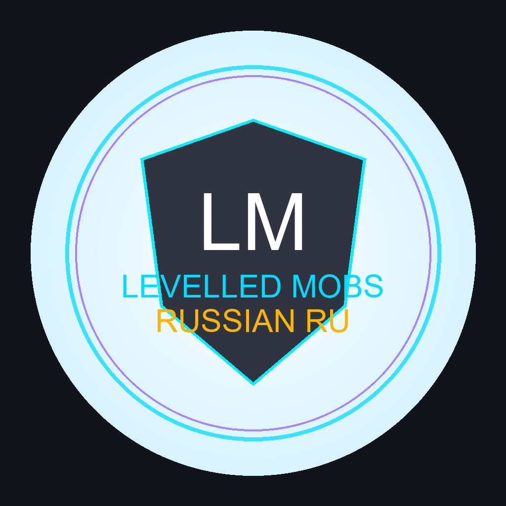

# LevelledMobs Full Russian Localization

  

  <strong>Comprehensive Russian localization and rules configuration for LevelledMobs v4</strong>

  
  

  <a href="#english">English</a> | <a href="#русский">Русский</a>

---

## English

### Overview

LevelledMobs is one of the most flexible RPG leveling engines for Minecraft Paper and Spigot servers. Out of the box, client-side translation components often fail to resolve properly on Bedrock clients (Geyser) or when custom naming systems interact, causing mobs to display English identifiers or raw keys.

This repository provides a production-ready Russian configuration and localization pack for LevelledMobs v4, including clean health and level nametags, customized death messages, full `entity-name-override` mapping for all Minecraft entities, and plug-and-play compatibility with external boss systems like Theosis and BloodMoonPlus.

### Features

- 100% translated messages (`messages.yml`): console commands, help pages, debug notices, egg summoning, and error messages.
- Polished nametag layout: `Ур. %mob-lvl% ༺ %displayname% ༻ %health%❤`.
- Explicit Russian entity dictionary: comprehensive mapping for all hostile, neutral, and passive mobs so client language fallbacks or Bedrock bridges never show raw English names.
- External boss compatibility: preserves custom display names of Theosis bosses, BloodMoon bosses, and Citizens NPCs without overwriting their nametags.
- Balanced leveling curve: silver challenge scaling tuned for vanilla-like progression.

### Quick Setup

1. Make sure LevelledMobs v4 is installed on your server (Paper / Spigot / Purpur 1.20 - 1.21.x).
2. Download the release files or clone this repository.
3. Place `rules.yml`, `messages.yml`, and `settings.yml` into your server directory at `plugins/LevelledMobs/`.
4. Run `/levelledmobs reload` in the server console.

---

## Русский

### О проекте

LevelledMobs дает гибкую систему прокачки монстров для Paper и Spigot серверов. По умолчанию плагин полагается на клиентские ключи локализации, из-за чего игроки с Bedrock (Geyser), кастомные клиенты или мобы с особыми атрибутами часто видят английские названия существ.

Этот репозиторий содержит готовую русскую конфигурацию и локализацию для LevelledMobs v4: аккуратный формат индикаторов здоровья и уровней, русские сообщения о смерти, полный справочник перевода названий всех существ Minecraft (`entity-name-override`) и бесконфликтную работу со сторонними плагинами боссов (Theosis, BloodMoonPlus).

### Возможности

- Полный перевод сообщений (`messages.yml`): команды консоли, справка, создание яиц призыва, уведомления об ошибках и лимитах.
- Читаемый формат неймтегов: `Ур. %mob-lvl% ༺ %displayname% ༻ %health%❤`.
- Полный словарь существ: русские названия для всех мобов (Зомби, Скелет, Крипер, Паук, Эндермен, Утопленник, Кадавр, Зимогор, Слизень, Магма-куб, Ифрит, Гаст, Визер-скелет, Ведьма, Разбойник, Поборник, Заклинатель, Разоритель, Шалкер, Варден, Бриз, Болотник, Скрипун и мирные животные). Имена остаются на русском даже при сбоях трансляции компонентов или входе через Geyser.
- Совместимость с боссами: специальные боссы из Theosis и BloodMoonPlus сохраняют свои уникальные титулы и шкалы здоровья без перезаписи плагином LevelledMobs.
- Сбалансированная кривая сложности: пресет серебряного уровня (silver challenge) для интересной, но честной игры.

### Установка

1. Убедитесь, что на сервере установлен LevelledMobs v4 (Paper / Spigot / Purpur 1.20 - 1.21.x).
2. Скачайте файлы конфигурации из последнего релиза.
3. Скопируйте файлы `rules.yml`, `messages.yml` и `settings.yml` в каталог `plugins/LevelledMobs/`.
4. Выполните команду `/levelledmobs reload` в консоли сервера.

---

### License

Distributed under the terms of the MIT License. Copyright (c) 2026 milkycloud-dev.
